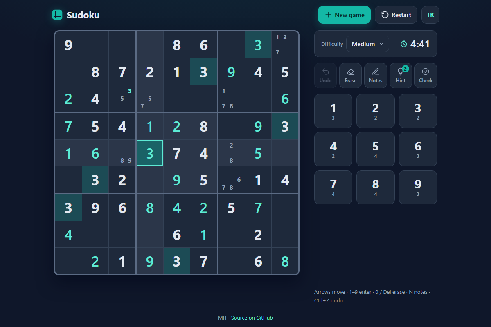

# Sudoku - a clean, mobile-friendly Sudoku where every puzzle has exactly one solution

[](#tests)
[](LICENSE)

**▶ Play now: https://celaldrg.github.io/sudoku/**



## Features

- **Unique solutions, guaranteed.** Puzzles are generated in your browser from a seeded random full grid. Cells are removed one at a time, and a removal is kept only while the solver still finds exactly one solution. The test suite proves this for 30 generated puzzles.
- **Three difficulties:** Easy (38–40 givens), Medium (31–33) and Hard (26–28). A new puzzle takes a few milliseconds.
- **Pencil notes** that tidy themselves: placing a digit removes it from the notes in the same row, column and box.
- **Undo**, **3 hints per game** (naked singles first) and **Check**, which marks wrong entries in red. Rule conflicts are shown as you type.
- **Highlights** for the selected cell's row, column and box and for matching digits. The number pad shows how many of each digit are still missing.
- **Timer, auto-save and resume:** close the tab and carry on later. A dialog shows your time when you win.
- **English and Turkish** interface; your choice is remembered.
- **Keyboard and touch**, mobile-first layout, and it respects `prefers-reduced-motion`.
- Vanilla JavaScript ES modules: no build step, no dependencies and no external requests.

## How to play

Fill the grid so that every row, every column and every 3×3 box contains the digits 1–9 exactly once.

**Touch / mouse:** tap a cell, then tap a digit on the number pad. Turn on **Notes** to add pencil marks. Use **Erase** to clear a cell, **Hint** to reveal one cell and **Check** to find mistakes.

**Keyboard:**

| Key | Action |
| --- | --- |
| Arrow keys | Move the selection |
| 1–9 | Enter a digit (or a note in notes mode) |
| Backspace / Delete / 0 | Erase the cell |
| N | Turn notes mode on or off |
| Ctrl+Z / Cmd+Z | Undo |

Add `?lang=tr` to the URL to open the game in Turkish.

## Run locally

Any static file server works, for example:

```sh
npx serve .
```

Then open the address it prints. ES modules need `http://`, so opening `index.html` straight from disk (`file://`) will not work.

## Tests

```sh
node --test
```

The tests need Node 20 or newer and no packages. CI runs them on Node 22 for every push and pull request. They are deterministic and finish in under a second. They cover:

- **Generator:** 10 seeds × 3 difficulties. Each puzzle has exactly one solution, its givens match that solution and the number of givens is in range.
- **Solver:** a classic puzzle, a known hard puzzle and a 17-given puzzle. `countSolutions` detects multiple solutions on under-constrained grids. Invalid and contradictory grids are rejected.
- **Rules:** row, column and box conflicts, completeness and mistakes.
- **Hints:** they prefer naked singles, fix wrong entries, and following hints alone solves a puzzle.
- **Game state:** undo, notes, locked givens, winning, timer, save and restore, and the demo state.
- **UI logic:** English and Turkish have the same strings and placeholders. Also covered: keyboard mapping, highlight rules, and a storage helper that survives broken storage.

## Project structure

```text
index.html          page shell
style.css           dark, responsive styles
src/
  rng.js            seeded random numbers (mulberry32) and shuffle
  board.js          grid geometry and digit bitmasks
  solver.js         bitmask backtracking solver (fewest candidates first), countSolutions
  generator.js      unique-solution puzzle generator
  validate.js       conflicts, completeness, mistakes
  hint.js           picks the next hint
  game.js           pure game state and actions (undo, notes, hints, save/restore)
  highlight.js      which cells to highlight
  keys.js           keyboard to command mapping
  i18n.js           English and Turkish strings
  storage.js        crash-proof localStorage helper
  view.js           DOM rendering of the board and number pad
  dialogs.js        <dialog> helpers
  main.js           entry point: events, timer, saving
test/               node:test suites
docs/screenshot.png
```

## License

[MIT](LICENSE) © 2026 Celalettin Durgaç

---

## Türkçe

Her bulmacanın tek bir çözümü olan, sade ve mobil uyumlu bir Sudoku.

**▶ Hemen oyna: https://celaldrg.github.io/sudoku/**

### Özellikler

- **Tek çözüm garantisi.** Bulmacalar tarayıcıda, tohumlu rastgele sayılarla üretilen dolu bir tablodan oluşturulur. Hücreler tek tek silinir. Bir silme ancak çözücü hâlâ tam olarak bir çözüm buluyorsa kalır. Testler bunu üretilen 30 bulmacada kanıtlar.
- **Üç zorluk:** Kolay (38–40 verilen rakam), Orta (31–33) ve Zor (26–28). Yeni bir bulmaca birkaç milisaniyede hazır olur.
- **Kendini toplayan notlar:** bir rakam yerleştirince aynı satır, sütun ve kutudaki notlardan o rakam silinir.
- **Geri al**, **oyun başına 3 ipucu** (önce tek adaylı hücreler) ve yanlış girişleri kırmızıyla işaretleyen **Kontrol**. Kural çakışmaları yazarken görünür.
- Seçili hücrenin satırı, sütunu ve kutusu ile aynı rakamlar **vurgulanır**. Sayı tuşları her rakamdan kaç tane eksik kaldığını gösterir.
- **Süre, otomatik kayıt ve kaldığın yerden devam.** Kazandığında bir pencere süreni gösterir.
- **Türkçe ve İngilizce** arayüz; seçimin hatırlanır.
- **Klavye ve dokunmatik** destek, mobil öncelikli tasarım; `prefers-reduced-motion` ayarına uyar.
- Saf JavaScript ES modülleri: derleme adımı yok, bağımlılık yok, dış istek yok.

### Nasıl oynanır

Tabloyu, her satırda, her sütunda ve her 3×3 kutuda 1–9 rakamları birer kez yer alacak şekilde doldur.

**Dokunmatik / fare:** bir hücreye dokun, sonra sayı tuşlarından bir rakam seç. Not almak için **Notlar**'ı aç. Hücreyi temizlemek için **Sil**'i, bir hücreyi açmak için **İpucu**'nu, hataları bulmak için **Kontrol**'ü kullan.

**Klavye:**

| Tuş | İşlev |
| --- | --- |
| Ok tuşları | Seçimi taşı |
| 1–9 | Rakam gir (not modunda not ekle) |
| Backspace / Delete / 0 | Hücreyi sil |
| N | Not modunu aç/kapat |
| Ctrl+Z / Cmd+Z | Geri al |

Oyunu doğrudan Türkçe açmak için adrese `?lang=tr` ekle.

### Yerelde çalıştırma

Herhangi bir statik dosya sunucusu yeterli, örneğin:

```sh
npx serve .
```

Sonra yazdığı adresi aç. ES modülleri `http://` ister, `index.html` dosyasını diskten (`file://`) açmak çalışmaz.

### Testler

```sh
node --test
```

Testler Node 20 veya üstüyle, hiçbir paket kurmadan çalışır. CI her push ve pull request için Node 22'de çalıştırır. Testler deterministiktir ve bir saniyeden kısa sürer. Kapsam:

- **Üretici:** 10 tohum × 3 zorluk. Her bulmacanın tam olarak bir çözümü var, verilen rakamlar o çözümle uyuşuyor ve sayıları aralıkta.
- **Çözücü:** klasik, bilinen zor ve 17 rakamla verilmiş bulmacalar. `countSolutions`, eksik kısıtlı tablolarda birden çok çözümü yakalar. Geçersiz ve çelişkili tablolar reddedilir.
- **Kurallar:** satır, sütun ve kutu çakışmaları, tamamlanma ve hatalar.
- **İpuçları:** önce tek adaylı hücreler gelir, yanlış girişler düzeltilir ve yalnızca ipuçlarıyla bulmaca çözülür.
- **Oyun durumu:** geri alma, notlar, kilitli rakamlar, kazanma, süre, kayıt/geri yükleme ve demo durumu.
- **Arayüz mantığı:** İngilizce ve Türkçe metinlerde aynı anahtarlar ve yer tutucular var. Klavye eşlemesi, vurgu kuralları ve bozuk depolamada çökmeyen depolama yardımcısı da test edilir.

### Lisans

[MIT](LICENSE) © 2026 Celalettin Durgaç
